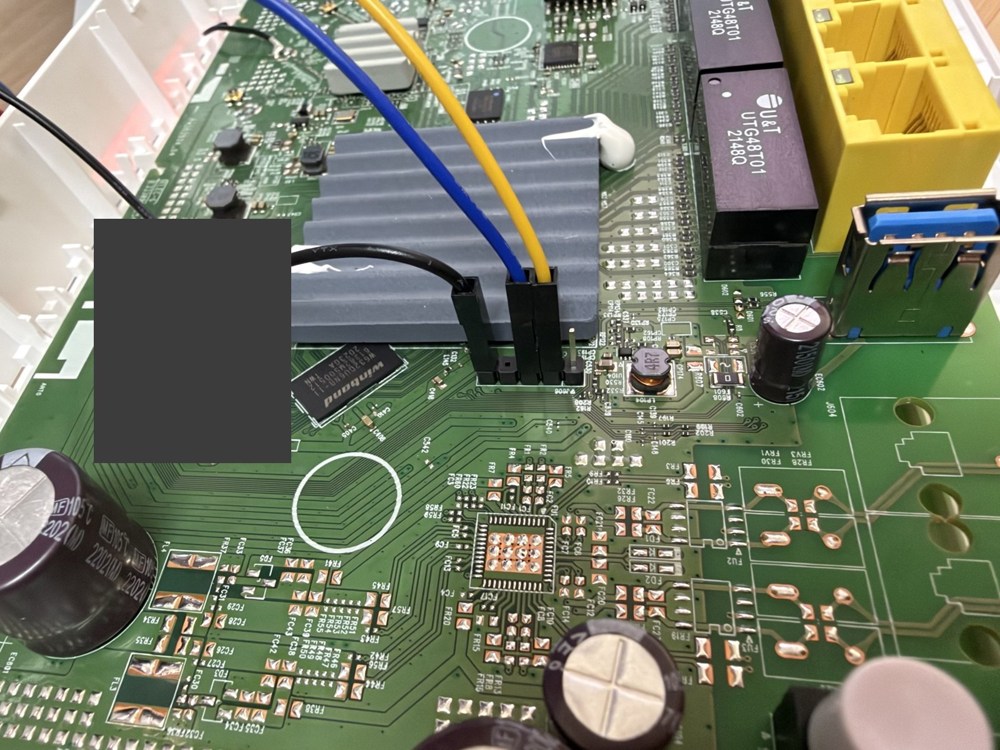

# OpenWrt for Zyxel O2 GateWay

An independent OpenWrt 25.12.6 / Linux 6.12.112 port for the **Zyxel O2 GateWay**,
the EcoNet EN751627 (MIPS 1004Kc, 4 threads) router distributed by O2 Czech Republic.
Maintained by [AidenShaw2020](https://github.com/AidenShaw2020).

The tested unit boots OpenWrt from its own SPI NAND through the unmodified stock
bootloader, with a read-only squashfs root and a writable UBIFS overlay. The
stock firmware is replaced; the bootloader, manufacturing data and Wi-Fi
calibration stay untouched. This project is not affiliated with Zyxel, O2,
EcoNet/Airoha, MediaTek or the OpenWrt project.



## Release Contents

This is a **source-only project**: the EN751627 subtarget, device tree, kernel
and package patches, board scripts, a configuration seed, an exported patch
against vanilla OpenWrt, helper tools and installation instructions. Build
your own images from the pinned upstream sources. No prebuilt firmware,
vendor firmware or device backup is distributed here.

- `target/linux/econet/`: EN751627 subtarget, DTS, image recipes, kernel
  patches, board scripts (`board.d`, LEDs, WPS, `sysupgrade`, boot flag tool).
- `package/kernel/econet-eth/`: EN751627 changes for the out-of-tree EcoNet
  Ethernet driver (DSA special tag, IRQ mask, boot-time loading).
- `package/kernel/linux/modules/usb.mk`: USB module recipe adjustment.
- `zyxel-o2-openwrt-25.12.6-bringup.patch`: the complete overlay as one patch
  against vanilla OpenWrt.
- `zyxel-o2-gateway.config`: configuration seed for the flash firmware.
- `tools/`: ATENv3 bootloader-unlock calculator and a UART/TFTP RAM-boot helper.
- `docs/`: [hardware](docs/HARDWARE.md), [installation](docs/INSTALL.md),
  [validation](docs/VALIDATION.md), [privacy review](docs/PRIVACY.md),
  [build inputs](docs/SOURCES.md).
- `SHA256SUMS`: checksum of the exported patch, not of your own build.

The repository layout is an overlay, **not** a complete OpenWrt checkout.
Use the exported patch once; do not also copy the same overlay on top.

## Tested Functionality

- Boot from NAND through the stock bootloader (main `tclinux` slot), squashfs
  root, UBIFS overlay on the former OEM slave/data area (72 MiB).
- EcoNet BMT/BBT handling compatible with the stock bootloader (`en75_bmt`).
- `sysupgrade` from LuCI or the shell, with and without keeping settings.
- Factory reset (RESET held ≥ 5 s) and failsafe with network on `192.168.1.1`.
- 4 × LAN + WAN through the integrated MT7530-compatible switch (DSA), WAN DHCP,
  routing/NAT, LAN DHCP/DNS and LuCI over HTTP.
- MT7615 dual-band (2.4 + 5 GHz DBDC) AP with WPA2, calibration read from flash.
- WPS push button (hostapd `wpad-mbedtls`), WLAN on/off and RESET buttons.
- All front LEDs mapped from the stock `led.conf`: power, Internet, LAN, WAN,
  WLAN 2.4/5 GHz, WPS; Internet LED follows the WAN interface state.
- MAC addresses from the stock manufacturing data (LAN = base, WAN = base + 1).
- USB storage detection and reading on a USB 2.0 port.

Only one unit (stock firmware `V5.50(ACBD.0)b2`, Bootbase `V1.46`, zloader
`v1.4.6`) has been tested. See [Validation](docs/VALIDATION.md) for the scope
and the known limitations. DSL and the FXS phone port are **not supported**
(no open drivers); the DSL and phone LEDs are only available as plain GPIO LEDs.

## Build

Use a Linux host with the normal
[OpenWrt build prerequisites](https://openwrt.org/docs/guide-developer/toolchain/install-buildsystem).
Pin these revisions:

| Source | Revision |
| --- | --- |
| OpenWrt v25.12.6 | `64900e756efa667774214f9c6b17c113222e01f7` |
| packages feed | `093d551675b1119a06ef224d419905e8d6b2af1a` |
| LuCI feed | `75a306df84a020c57a631ef5b4c02ace56d93387` |

```sh
git clone https://github.com/AidenShaw2020/openwrt-zyxel-o2-gateway.git
git clone https://git.openwrt.org/openwrt/openwrt.git
cd openwrt
git checkout 64900e756efa667774214f9c6b17c113222e01f7
git apply --check ../openwrt-zyxel-o2-gateway/zyxel-o2-openwrt-25.12.6-bringup.patch
git apply ../openwrt-zyxel-o2-gateway/zyxel-o2-openwrt-25.12.6-bringup.patch
cat > feeds.conf <<'EOF'
src-git packages https://git.openwrt.org/feed/packages.git^093d551675b1119a06ef224d419905e8d6b2af1a
src-git luci https://git.openwrt.org/project/luci.git^75a306df84a020c57a631ef5b4c02ace56d93387
EOF
./scripts/feeds update -a
./scripts/feeds install -a
cp ../openwrt-zyxel-o2-gateway/zyxel-o2-gateway.config .config
make defconfig
make download
make -j"$(nproc)"
```

Expected outputs in `bin/targets/econet/en751627/`:

- `openwrt-econet-en751627-zyxel_o2-gateway-initramfs-kernel.bin`: RAM boot
  through the bootloader (installation and recovery).
- `openwrt-econet-en751627-zyxel_o2-gateway-squashfs-tclinux.trx`: raw image
  for the `tclinux` NAND slot (first installation).
- `openwrt-econet-en751627-zyxel_o2-gateway-squashfs-sysupgrade.bin`: the same
  image with OpenWrt metadata for `sysupgrade`/LuCI.

The seed sets a neutral kernel build identity (`builder@buildhost`). A new build
is not byte-identical to the privately tested images. Audit your own images
before redistributing them.

The patch also contains RAM-only development profiles
(`zyxel_o2-gateway-ram`, `-ap-probe`, `-usb-probe`, `-ethernet-probe`) used during
bring-up; the flash device DTS includes their device-tree chain. Only
`zyxel_o2-gateway` is meant for installation.

## Installation and Recovery

**Do not upload these files to the stock O2/Zyxel web updater.** They are not
vendor update packages. First installation needs the internal UART header
and is done from an OpenWrt image running in RAM, see
[Installation](docs/INSTALL.md). It covers UART wiring, the bootloader unlock,
RAM boot, private backups, the NAND layout change and the boot flag.

For a device **already running this port**, use the `squashfs-sysupgrade.bin`
image through LuCI (System → Backup / Flash Firmware) or `sysupgrade`. Do not
select the initramfs image for sysupgrade. Do not disconnect power while
flashing.

The bootloader is never modified. If the flash firmware does not start, the
bootloader stays in its prompt and any initramfs image can be booted from RAM
again over UART and TFTP ([Recovery](docs/INSTALL.md#recovery)).

## Operation

- LAN and HTTP LuCI: `http://192.168.1.1/`.
- SSH: `root@192.168.1.1`; fresh defaults have no root password.
- Set a strong root password immediately and keep management on a trusted LAN.
- Wi-Fi is disabled by default; configure it under Network → Wireless.
- RESET pressed for less than one second: reboot, preserving settings.
- RESET held for at least five seconds, then released: factory reset of the
  OpenWrt settings. It does not restore the vendor firmware.
- Failsafe: press `f` + Enter on the UART console, or press RESET when the
  power LED starts blinking during boot. LAN port 1 then answers on `192.168.1.1`.
- WPS button: push-button pairing on both bands; the amber WPS LED blinks
  while a session is active.

HTTP is intentionally enabled; use a trusted management network and configure
HTTPS before untrusted access.

## License and Credits

The overlay's original, otherwise unmarked code and documentation are
GPL-2.0-only. Explicit per-file licenses take precedence. Upstream patches and
dependencies retain their original licenses and notices. This does not
relicense OpenWrt or dependencies. See [LICENSE](LICENSE),
[Licensing](LICENSES/README.md) and [Third-Party Notices](THIRD_PARTY_NOTICES.md).

This port builds on the OpenWrt `econet` target, the EN7528 kernel work by
Ahmed Naseef and Caleb James DeLisle's EcoNet Ethernet driver, BMT driver and
ATENv3 research.

No device backups, calibration data, MAC addresses, serial numbers, passwords,
vendor firmware or raw diagnostic logs are included. Hardware modification
and firmware installation are at your own risk; there is no warranty.
