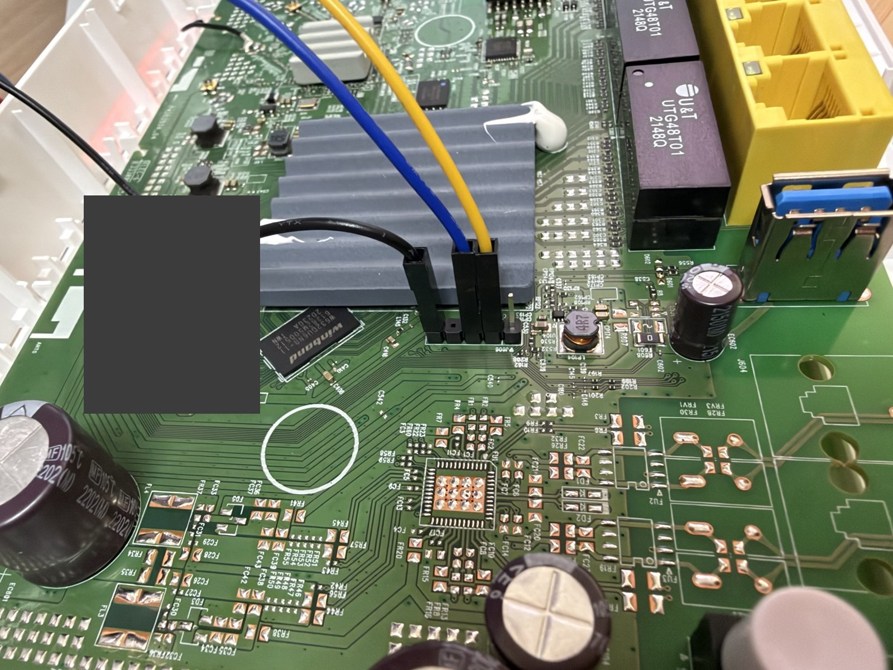

# Hardware

Tested unit: **Zyxel O2 GateWay** (ATSH product model `ZYXEL O2 GateWay`),
stock firmware `V5.50(ACBD.0)b2`, Bootbase `V1.46`, ZyXEL zloader `v1.4.6`.
The retail Zyxel model this board is related to has not been confirmed.

| Part | Details |
| --- | --- |
| SoC | EcoNet EN751627 (EN7528 family), MIPS 1004Kc, 4 threads |
| RAM | 256 MiB installed; 240 MiB used, matching the stock firmware's System RAM map |
| Flash | Winbond W25N01G SPI NAND, 128 MiB, 128 KiB blocks, 2048 + 64 B pages |
| Ethernet | Integrated MT7530-compatible switch: 4 × LAN + 1 × WAN, 1 Gb/s, via `econet_eth` (DSA) |
| Wi-Fi | MediaTek MT7615 on PCIe port 0, DBDC 2.4 GHz + 5 GHz |
| USB | xHCI: one USB 3.0 port (USB 2.0 + 3.0 root hubs) |
| Not supported | VDSL modem, FXS phone port, PCIe port 1 (nothing enumerates) |

## UART

The UART header **J606** is the five-pin row at the edge of the large SoC
heatsink, next to the Winbond NAND chip.

`115200 8N1`, 3.3 V logic. Pin order in the photo, from left (NAND chip side)
to right (USB port side):

| Position | Signal | Wire in photo |
| --- | --- | --- |
| 1 | GND | black |
| 2 | unused | — |
| 3 | RXD (router receive) | blue |
| 4 | TXD (router transmit) | yellow |
| 5 | VCC 3.3 V | **do not connect** |

Connect the router TXD to the adapter RX and the router RXD to the adapter TX.
Use a 3.3 V USB-UART adapter and leave VCC unconnected; power the router
from its own supply. Keep DTR/RTS of the adapter deasserted if your terminal
software toggles them.

The stock bootloader prints `Hit any key to stop autoboot` for a few seconds.
Pressing Enter stops it at the `ZHAL>` prompt. Do not confuse it with the earlier
`Press 'x' or 'b' key ... bootloader upgrade` prompt; never enter a bootloader
upgrade.

## NAND layout and bad-block management

The stock bootloader keeps an EcoNet BMT pool in the last 81 blocks
(`bmt pool size: 81`, blocks 943–1023). The BBT (`RAWB` signature) is in block
943, the BMT in block 1023. On the tested unit both tables were empty: no
factory bad blocks and no remapped blocks. The O2 bootloader checksums only
the first 250 BBT entries; `920-en75-bmt-accept-250-entry-bbt-checksum.patch`
lets `en75_bmt` accept that table. The BBT is never rewritten.

| Partition | Offset | Size | OpenWrt use |
| --- | --- | --- | --- |
| `bootloader` | `0x0` | `0x40000` | read-only; manufacturing data incl. base MAC at `0xff48` |
| `romfile` | `0x40000` | `0x40000` | read-only |
| `tclinux` | `0x80000` | `0x2800000` | `tclinux.trx`: 256 B header, LZMA kernel, squashfs at +`0x400000` |
| `rootfs` | `0x480000` | `0x2400000` | nested in `tclinux`, root device |
| `ubi` | `0x2880000` | `0x4ca0000` | UBI with `rootfs_data` (former stock slave slot, wwan, data, rom-d, misc) |
| `reservearea` | `0x7520000` | `0xc0000` | read-only; MT7615 calibration at `0x20000` (`0x4da8` bytes, nvmem) |
| `bootflag` | `0x75c0000` | `0x20000` | nested in `reservearea`, writable for `en75_chboot` |

The SPI controller uses the manual-mode `airoha,en7523-spi` driver
(`CONFIG_SPI_AIROHA_EN7523`) and keeps the bootloader's clock setting.

## Bootloader and boot flag

At power-on the bootloader checks both `tclinux` (main) and the former slave
slot: magic `2RDH`, header length 256 (EcoNet) or 372 (Zyxel), and a JAMCRC of
the body. It boots the slot selected by the boot flag and falls back to the
other valid slot, rewriting the flag. If no slot is valid, it stays at its
prompt, from where an image can be loaded into RAM again.

The flag is an ASCII `0` (main) or `1` (slave) at `reservearea + 0xa0fff`
(absolute `0x75c0fff`). `en75_chboot openwrt` writes `0`. The bootloader's own
`ATSW`/`ATCF` commands refuse to write it ("Can't write to protected Flash").
After installation the slave area holds UBI, so only the main slot is valid.

Useful ZHAL/bldr commands: `ATSH` (manufacturing data), `ATSE <model>` /
`ATEN 1,<password>` (BootExtension unlock, see `tools/atenv3.py`),
`ATLD <name>,0x80020000` (the loader becomes a **TFTP server** on
`192.168.1.1`; the PC uploads), `ATGU` (to `bldr>`), `dump <addr> <len>`,
`jump 80020000`, `imginfo`, `mtd`. Ctrl+C aborts a stuck `ATLD` transfer.

## LEDs and buttons

GPIO map taken from the stock `/userfs/led.conf`; all LEDs are active low.
GPIO 32–63 are `&gpio1 0–31` in the DTS.

| LED | GPIO | OpenWrt default |
| --- | --- | --- |
| `green:power` / `red:power` | 8 / 6 | on / failsafe and boot indication |
| `green:internet` / `red:internet` | 4 / 3 | WAN up / WAN has carrier but is down |
| `green:lan` | 38 | netdev `br-lan` |
| `green:wan` | 39 | netdev `wan` |
| `green:wlan2g` / `green:wlan5g` | 21 / 20 | netdev `phy0-ap0` / `phy1-ap0` |
| `amber:wps` / `amber:wps5g` | 23 / 22 | blinking during WPS; shares the housing with the green WLAN LED |
| `green:phone` / `amber:phone` | 9 / 10 | unused |
| `green:dsl` | 5 | unused |

Buttons (active low, polled): RESET GPIO 0, LED switch GPIO 1, WLAN GPIO 2,
WPS GPIO 28.

## MAC addresses

The manufacturing data hold one base MAC with 16 consecutive addresses. LAN
(`eth0`) uses the base address through an nvmem `mac-base` cell, WAN uses
base + 1. The Wi-Fi interfaces use the addresses from the MT7615 calibration.
